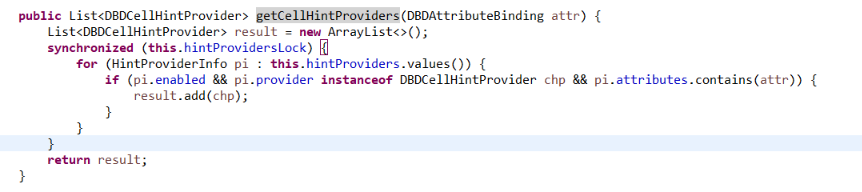
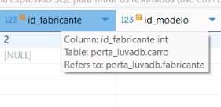
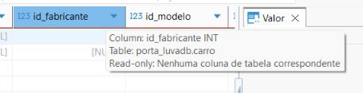

# Semana 6

Durante a semana tentei executar o codigo e encontrar a raiz do problema.

## Pontos de rastreio:

- **`ResultSetViewer.navigateAssociation`:** onde é chamado quando o botão de referência da chave estrangeira é clicado

- **`ReferenceCellHintProvider.getCellHints`:** chamado quando o campo com chave estrangeira aparee no resultado da query (não ocorre no bug)

- **`ResultSetHintContext.getCellHintProviders`:** verificador se é necessário chamar getCellHints

Nesse trecho é onde se percebe algum indicativo do bug. Aparecer diferentes valores de `hintProviders`, mas não o `DBDCellHintProvider`, do qual é necessário para passar pelo if e gerar o atalho de referência.

## Aqui notei uma leve diferença dos campos no resultado da query

### Sem o bug:

### Com o bug:

---

Rastreando um pouco mais vi que esses `hintProviders` estão sendo populados com esse objeto faltando em `ResultSetHintContext.initProviders`

Na próxima semana vou entrar mais a fundo nesse `initProviders` e seguir com a depuração do codigo

Obs.: To procurando melhorar a formatação, aproveitando melhor o arquivo .md.